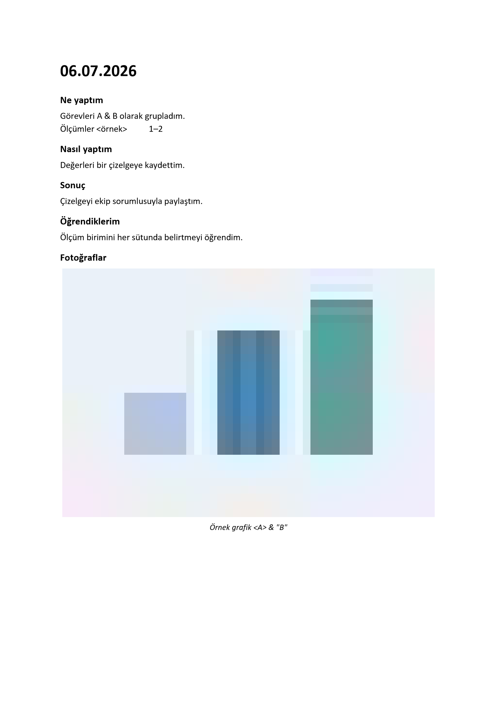

# Staj Defteri

Staj Defteri, öğrencilerin staj bilgilerini ve günlük çalışmalarını kaydedip düzenlenebilir bir Word raporuna dönüştürdüğü ücretsiz bir iOS uygulamasıdır. SwiftUI ile geliştirilmiştir ve iOS 17 ve üzerini hedefler. Kayıt, fotoğraf işleme ve DOCX üretimi cihazda gerçekleşir.

## Kullanım

1. Öğrenci bilgilerini, staj yerini ve staj tarihlerini girin.
2. Tarihli bir günlük açın ve **Ne yaptım**, **Nasıl yaptım**, **Sonuç** ve **Öğrendiklerim** alanlarını doldurun. Fotoğraf seçebilir veya kamerayla çekebilir, her fotoğrafa açıklama ekleyebilirsiniz.
3. Kaydedilen stajları ve günlükleri yeniden açın, düzenleyin veya silin.
4. Stajın içinden **Word belgesi oluştur** seçeneğini kullanın. Kapakta staj bilgileri yer alır ve her günlük yeni bir sayfada başlar. Öğrencinin girdiği metin, fotoğraflar ve açıklamalar rapora aktarılır. Word'de metni ve açıklamaları düzenleyebilirsiniz.



*Test verileriyle üretilen bir günlük sayfası. Görüntü Microsoft Word çıktısından alınmıştır.*

## Mimari

- **iOS uygulaması.** SwiftUI staj ve günlük ekranlarını, UIKit ve AVFoundation kamera akışını, PhotosPicker ise seçilen fotoğrafların içe aktarımını yönetir. Belge, iOS paylaşım ekranından kullanıcının seçtiği konuma veya uygulamaya gönderilir. [Uygulama kaynakları](Sources/StajDefteriApp)
- **Yerel veri bütünlüğü.** Foundation tabanlı Swift paketindeki `JournalStore` actor'ı okuma ve yazmaları sıraya alır. Uygulamanın özel alanında sürümlü bir JSON dosyası ve ayrı JPEG dosyaları saklanır. Yeni fotoğraflar yazıldıktan sonra JSON atomik olarak değiştirilir. Başarısız yazımda önceki kayıt korunur, kullanım dışı kalan fotoğraflar başarılı işlemden sonra temizlenir. Günlük tarihleri saat dilimi değişse de aynı takvim gününü temsil eder. [Veri katmanı](Sources/StajDefteriCore/JournalStore.swift) · [Veri modelleri](Sources/StajDefteriCore/Models.swift)
- **DOCX üretimi.** Dışa aktarım, güncel kayıtlar ve onlara bağlı fotoğrafların birlikte okunmasıyla başlar. Üretici, öğrencinin metnini düzenlenebilir WordprocessingML paragraflarına yerleştirir, JPEG dosyalarını pakete gömer ve her günlük başlığına sayfa başlangıcı kuralı uygular. DOCX yerel olarak oluşturulur ve üçüncü taraf kütüphane gerektirmez. [DOCX üreticisi](Sources/StajDefteriCore/DOCXExporter.swift)

## Doğrulama

| Kapsam | Sonuç |
| --- | --- |
| Swift paket testleri | Linux üzerinde **7/7 geçti**. Kayıtları yeniden açma, düzenleme, silme, yazma hatasından sonra tekrar deneme, takvim tarihi, DOCX yapısı ve güncel kayıtlardan dışa aktarım sınandı. |
| Microsoft Word | Swift'in ürettiği örnek DOCX Windows'ta Word ile açıldı. Kapak ve iki günlük üç sayfada görüntülendi. Gömülü fotoğraflar ve açıklamalar incelendi. Günlük metni düzenlendi ve yeniden açıldığında değişikliğin korunduğu doğrulandı. |
| iOS | Xcode proje dosyası ve Swift kaynaklarının sözdizimi statik olarak kontrol edildi. Mac tabanlı CI iş akışı Swift testlerini, iOS arşiv derlemesini ve simülatörde uygulamayı başlatmayı kapsar. Kamera izin akışı gerçek cihazda doğrulanır. |

[Swift testleri](Tests/StajDefteriCoreTests) · [iOS CI iş akışı](.github/workflows/ios.yml)

## Yerelde çalıştırma

iOS uygulamasını çalıştırmak için macOS üzerinde Xcode 15 veya üzeri gerekir.

```sh
git clone https://github.com/sanlibrk/Staj-Defterim-Mobil-Uygulama.git
cd Staj-Defterim-Mobil-Uygulama
open StajDefteri.xcodeproj
```

Xcode'da **StajDefteri** şemasını ve iOS 17 veya üzeri bir iPhone ya da iPad simülatörünü seçin. Gerçek cihaz için **Signing & Capabilities** altında geliştirme ekibinizi belirleyin. Kamera çekimini gerçek cihazda deneyin.

Platformdan bağımsız çekirdek testlerini depo kökünden çalıştırın.

```sh
swift test
```

## English summary

Staj Defteri is a free, offline SwiftUI internship journal for iOS 17 and later. Students can log their daily work, attach captioned photos, and export an editable Word document with a cover and a new page for each day. A Foundation-only Swift package handles local storage and DOCX generation. The core passed seven automated tests, and a generated report was opened, visually checked, edited, and saved in Microsoft Word.
